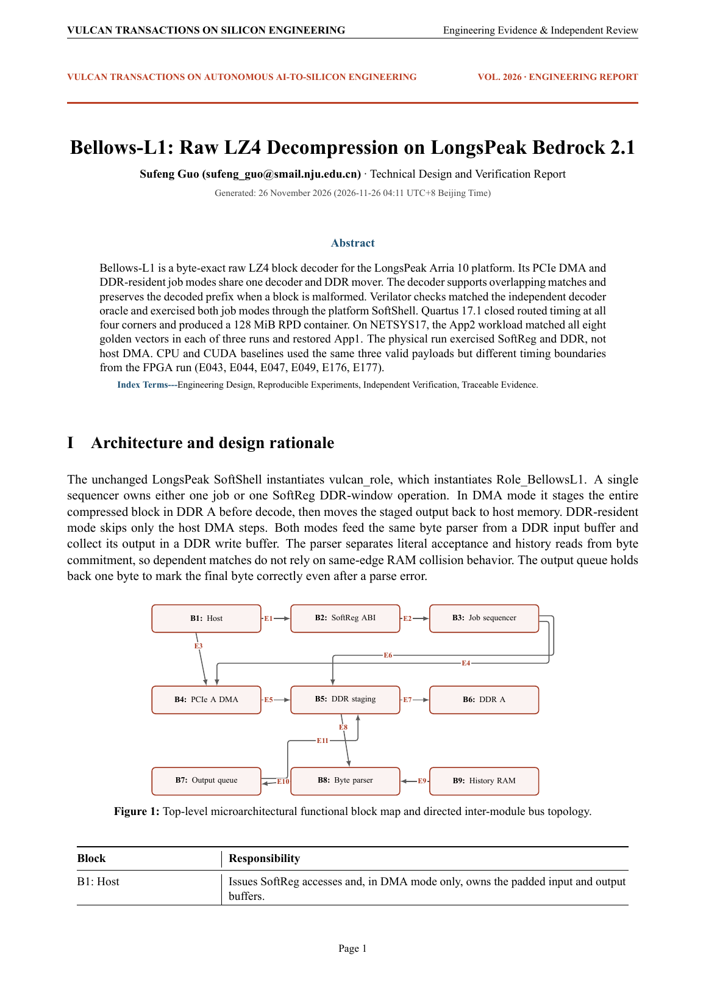
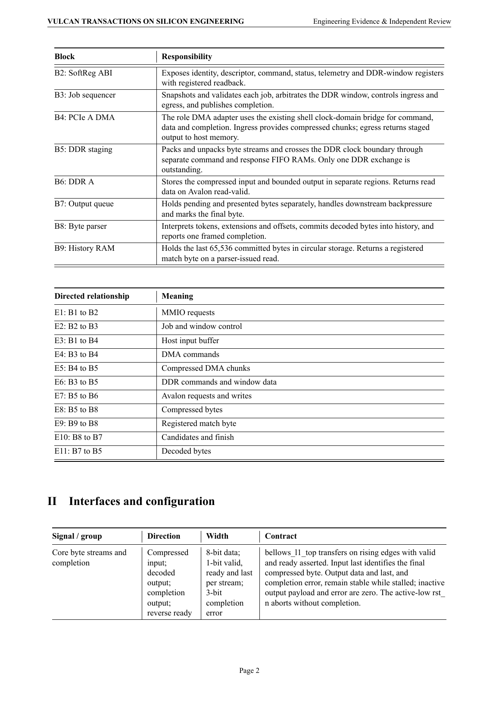
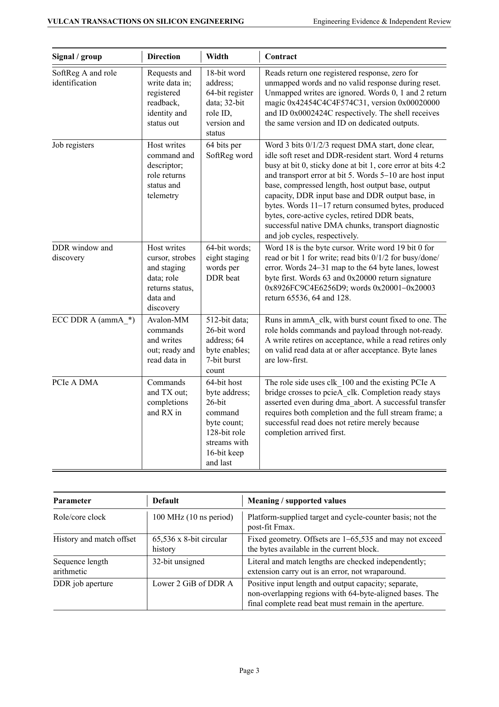
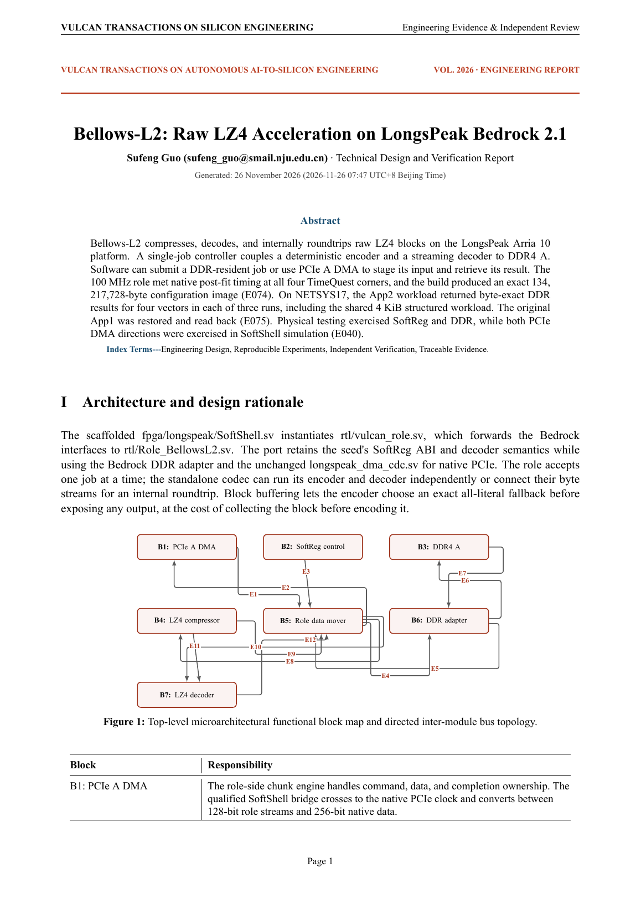
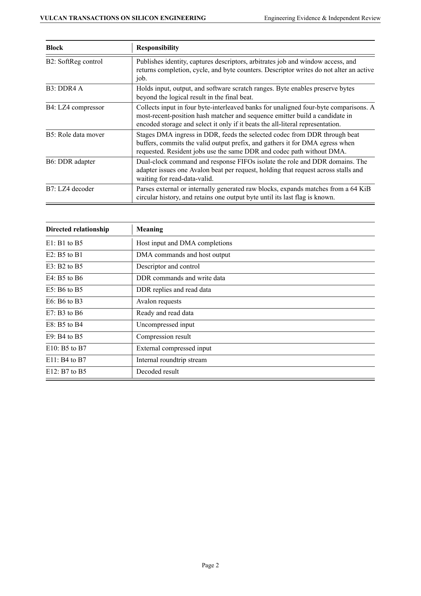
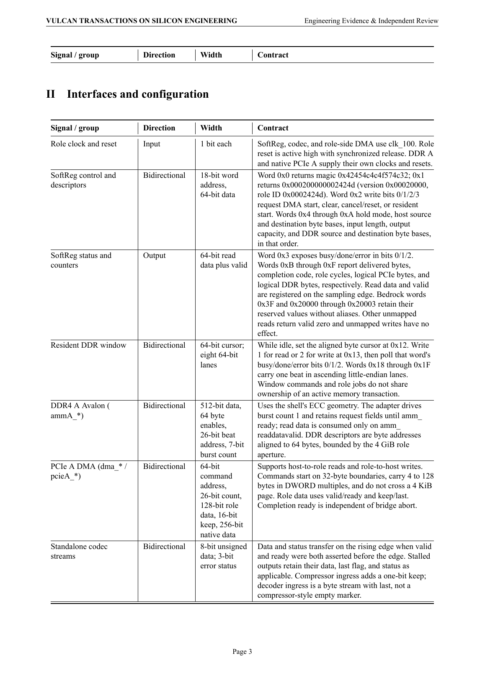

<div align="center">
  <picture>
    <source media="(prefers-color-scheme: dark)" srcset="brand/logo-dark.svg">
    
  </picture>
  <h1>Bellows-L · Lossless Streaming Compression Silicon</h1>
  <p><strong>Synthesizable 100 MHz+ LZ4 Decompression & Full-Duplex Hash-Match Compression · Intel Arria 10 GX Full-Shell STA & PCIe Gen3x8 HIL</strong></p>
  <p>
    
    
    
    
    
  </p>
  <p>
    <a href="https://github.com/aHappend/vulcan-showcase"><strong>Vulcan Showcase</strong></a> · <a href="https://github.com/aHappend/bellows-l">Bellows-L (LZ4)</a> · <a href="https://github.com/aHappend/billet-t">Billet-T (FFT)</a> · <a href="https://github.com/aHappend/billet-f">Billet-F (FIR)</a> · <a href="https://github.com/aHappend/crucible-g">Crucible-G (3D)</a> · <a href="https://github.com/aHappend/furnace-x">Furnace-X (DMA/CRC)</a> · <a href="https://github.com/aHappend/hammer-v">Hammer-V (RISC-V)</a> · <a href="https://github.com/aHappend/rivet-a">Rivet-A (AES-GCM)</a> · <a href="https://github.com/aHappend/rivet-h">Rivet-H (SHA-256)</a> · <a href="https://github.com/aHappend/swage-s">Swage-S (ISP)</a> · <a href="https://github.com/aHappend/sable">SABLE</a> · <a href="README.zh-CN.md"><strong>简体中文</strong></a>
  </p>
</div>

---

**Bellows-L** is the lossless data-compression line in the Vulcan silicon fleet, delivering hardware-accelerated LZ4 raw-block decompression (`BELLOWS-L1`) and full-duplex hardware hash-match compression plus decompression (`BELLOWS-L2`) integrated inside the full PCIe Gen3x8 + DDR4-2133 Arria 10 platform shell.

## Vulcan 3.0 Full-Shell Silicon Signoff Matrix

All chips in `chips/` are synthesized, placed, routed, and timing-closed inside the **complete Intel Arria 10 GX PCIe Gen3x8 + DDR4-2133 platform shell** (`10AX115N3F40E2SG`, Quartus Prime Standard `17.1.0`) and executed on physical board hardware (`board_hil`) alongside matched `AMD EPYC 7662` CPU and `NVIDIA Tesla V100` GPU baselines.

| Generation | Chip | Architecture & Verification Scope | Full-Shell 4-Corner STA | Whole-Shell Utilization (`10AX115`) | Physical Board HIL | Deliverables |
| :--- | :--- | :--- | :--- | :--- | :--- | :--- |
| **Gen-1 (v3.0)** | [**BELLOWS-L1**](chips/bellows-l1/) | Streaming LZ4 block decompressor · 64 KiB circular history SRAM, overlap RLE copy FSM & DDR4 burst DMA | **`133.71 MHz`** (`WNS +2.521 ns`)<br><sub>PCIe `279.02` · DDR4 `301.93 MHz`</sub> | `43,780 ALMs (10%)`<br><sub>`1 DSPs` · `206 M20K`</sub> | **PASSED**<br><sub>PCIe Gen3x8 + DDR4</sub> | [**`REPORT.pdf`**](chips/bellows-l1/REPORT.pdf) · [RTL](chips/bellows-l1/rtl/) |
| **Gen-2 (v3.0)** | [**BELLOWS-L2**](chips/bellows-l2/) | Full-duplex LZ4 hardware compressor + decompressor · On-chip hash-table match finder, literal buffer & token emitter | **`112.70 MHz`** (`WNS +1.127 ns`)<br><sub>PCIe `275.03` · DDR4 `297.53 MHz`</sub> | `46,320 ALMs (11%)`<br><sub>`1 DSPs` · `345 M20K`</sub> | **PASSED**<br><sub>PCIe Gen3x8 + DDR4</sub> | [**`REPORT.pdf`**](chips/bellows-l2/REPORT.pdf) · [RTL](chips/bellows-l2/rtl/) |

## Engineering Report Visual Preview

### BELLOWS-L1 · Vulcan 3.0 Engineering Report Preview ([`chips/bellows-l1/REPORT.pdf`](chips/bellows-l1/REPORT.pdf))
<table>
  <tr>
    <td align="center" width="33%"><a href="chips/bellows-l1/REPORT.pdf"></a><br><sub><strong>Page 1 · Executive Summary & Architecture</strong></sub></td>
    <td align="center" width="33%"><a href="chips/bellows-l1/REPORT.pdf"></a><br><sub><strong>Page 2 · Microarchitecture & Verification</strong></sub></td>
    <td align="center" width="33%"><a href="chips/bellows-l1/REPORT.pdf"></a><br><sub><strong>Page 3 · Full-Shell STA, HIL & Benchmarks</strong></sub></td>
  </tr>
</table>
### BELLOWS-L2 · Vulcan 3.0 Engineering Report Preview ([`chips/bellows-l2/REPORT.pdf`](chips/bellows-l2/REPORT.pdf))
<table>
  <tr>
    <td align="center" width="33%"><a href="chips/bellows-l2/REPORT.pdf"></a><br><sub><strong>Page 1 · Executive Summary & Architecture</strong></sub></td>
    <td align="center" width="33%"><a href="chips/bellows-l2/REPORT.pdf"></a><br><sub><strong>Page 2 · Microarchitecture & Verification</strong></sub></td>
    <td align="center" width="33%"><a href="chips/bellows-l2/REPORT.pdf"></a><br><sub><strong>Page 3 · Full-Shell STA, HIL & Benchmarks</strong></sub></td>
  </tr>
</table>

## Clean Repository Structure

```text
bellows-l/
├── README.md               # Formal English documentation
├── README.zh-CN.md         # Formal Simplified Chinese documentation
├── brand/                  # Light/dark vector identity assets
├── chips/
│   ├── bellows-l1/          # BELLOWS-L1 (RTL, tests, STA/HIL receipts, REPORT.pdf)
│   └── bellows-l2/          # BELLOWS-L2 (RTL, tests, STA/HIL receipts, REPORT.pdf)
├── archive-v2/             # Deduplicated pre-3.0 historical design snapshots
└── LICENSE                 # MIT License
```

## Historical Pre-3.0 Archive (`archive-v2/`)

Earlier pre-3.0 exploration snapshots ([`bellows-l3`](archive-v2/bellows-l3/), [`bellows-l4`](archive-v2/bellows-l4/), [`bellows-l5`](archive-v2/bellows-l5/)) are retained cleanly under [`archive-v2/`](archive-v2/README.md) with explicit standalone/simulation scope boundaries, separate from the full-shell silicon-verified `chips/` lineup above.
